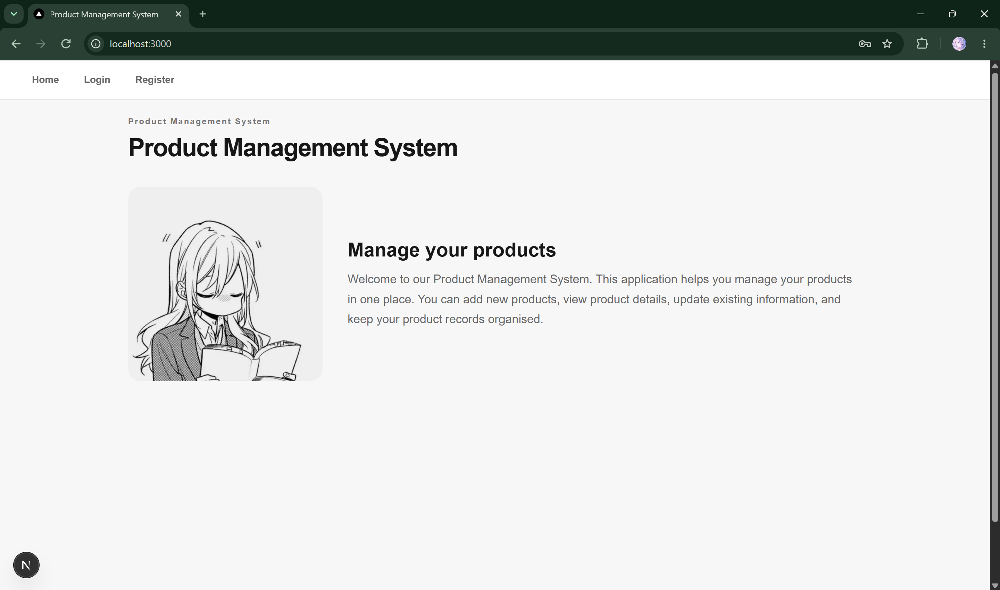
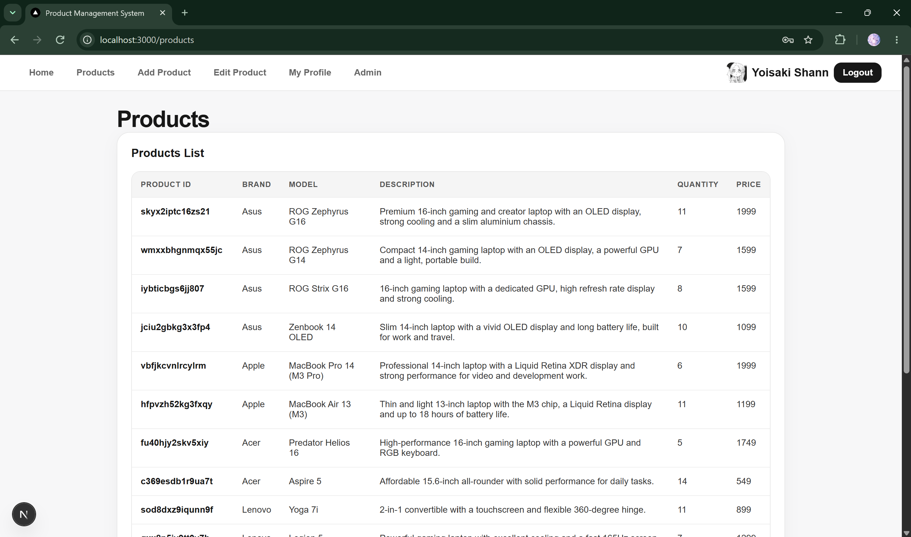
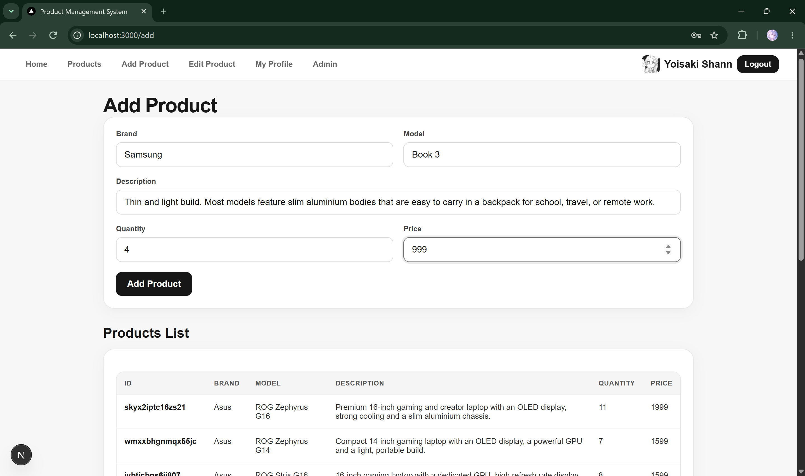
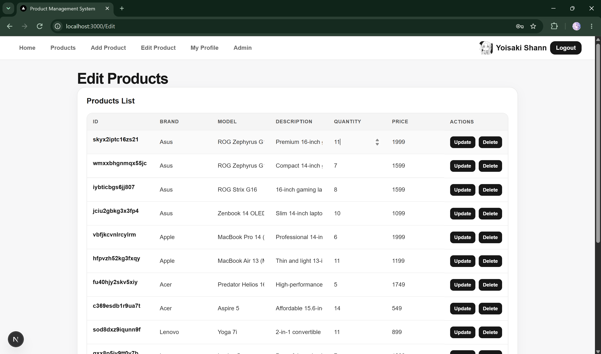
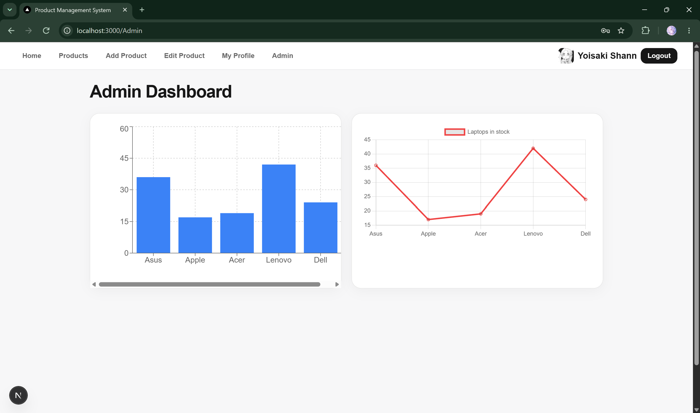

# Product Management System

A Next.js product management application with authentication, product CRUD operations, profile avatars, charts, Redis-powered homepage content, and PocketBase storage.

## Features

- User registration and login
- Create, view, edit, and delete products
- Admin dashboard with product charts
- User profile and avatar support
- Responsive interface
- Cloudinary image delivery with Next.js `Image` optimization
- Playwright end-to-end tests

## Technology

- Next.js 16 and React 19
- TypeScript
- PocketBase for authentication and product data
- Redis Cloud for homepage content
- Cloudinary for homepage image delivery
- Playwright for end-to-end testing

## Requirements

- Node.js 22 or later
- npm
- PocketBase
- Redis Cloud account, or another Redis-compatible server

## Installation

Clone the repository and install the dependencies:

```bash
git clone <repository-url>
cd Product-Management-System
npm ci
```

Create `.env.local` from `.env.example` and provide the PocketBase and Redis values.

Do not commit `.env.local` because it contains credentials.

## Start PocketBase

From the project directory, start PocketBase on its default port:

```powershell
.\pocketbase.exe serve
```

The application expects PocketBase at `http://127.0.0.1:8090` by default. The included migrations create the required collections when PocketBase starts.

## Run the application

```bash
npm run dev
```

Open [http://localhost:3000](http://localhost:3000).

## Testing

Install the Playwright browsers once:

```bash
npx playwright install
```

Run the end-to-end tests:

```bash
npm run test:e2e
```

## Production build

```bash
npm run build
npm run start
```

## Screenshots

### Homepage



### Product management







### Admin dashboard



## Environment variables

See `.env.example` for the required PocketBase and Redis variables. The homepage Cloudinary image is configured in `app/page.tsx`; no Cloudinary API secret is required to display it.
